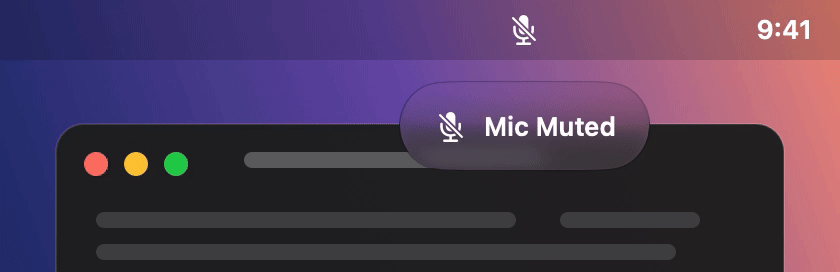

# mickey

Turn the 🎤 key (F5) on your MacBook into a real microphone switch.

<p align="center">
  
</p>

- **Tap**: mute or unmute the mic for the whole Mac, in every app at once.
- **Hold**: invert while the key is down. Push-to-talk while muted, a quick cough-mute while live.
- **Native feel**: a menu bar icon (click toggles it), a Liquid Glass bezel like the system volume HUD, and a click sound. Everything moves on springs: the bezel grows out of the icon and folds back into it, and the slash draws itself across the mic.
- **Always on**: it runs inside Hammerspoon, which starts at login. No app window, no dock icon.
- **Scriptable**: `mickey mute`, `mickey unmute`, `mickey status` from the terminal, for scripts and agents.

## Why not just mute in Meet?

Meet's own mute is a request to one app. mickey cuts the device: the mic is muted in CoreAudio, so every app gets silence at once, and switching tabs or apps changes nothing. It is the software version of a hardware mute switch.

One catch: Chrome watches the system mute, so Meet notices, says "muted by your system settings" and switches its own mic button off. It leaves the button off when you unmute with mickey, so unmute in Meet too.

## Requirements

- A Mac whose F5 key carries the microphone symbol (MacBook Pro and MacBook Air from 2021 on; on older keyboards F5 is keyboard brightness).
- macOS 14 or later. Tested on macOS 26 and 27. The Liquid Glass bezel needs macOS 26.
- [Hammerspoon](https://www.hammerspoon.org) runs the Lua module. `brew install --cask hammerspoon`
- [Karabiner-Elements](https://karabiner-elements.pqrs.org) turns the physical 🎤 key into F18, which Hammerspoon can bind. `brew install --cask karabiner-elements`

Both are free and open source. Give each the permissions it asks for on first launch (Accessibility for Hammerspoon, Input Monitoring and its driver for Karabiner), and enable "Launch at login" in both.

## Install

1. Clone anywhere, link the module into Hammerspoon and the `mickey` command into your PATH:

   ```bash
   git clone https://github.com/albert-mr/mickey.git
   cd mickey
   ln -sfn "$(pwd)/mickey.lua" ~/.hammerspoon/mickey.lua
   ln -sfn "$(pwd)/mickey" ~/.local/bin/mickey   # or any directory on your PATH
   printf '\nrequire("hs.ipc")\nmickey = require("mickey")\n' >> ~/.hammerspoon/init.lua
   ```

2. Map the 🎤 key to F18 in Karabiner-Elements. Either in the app: **Settings → Function Keys → f5 → f18**, or add this entry to `fn_function_keys` of your selected profile in `~/.config/karabiner/karabiner.json` (Karabiner reloads the file on its own):

   ```json
   {"from": {"key_code": "f5"}, "to": [{"key_code": "f18"}]}
   ```

   `fn+F5` stays a normal F5.

3. Optional, macOS 26 or later: build the Liquid Glass bezel (needs Xcode 26 or newer).

   ```bash
   swiftc -O bezel.swift -o mickey-bezel
   ```

   With `mickey-bezel` next to `mickey.lua`, the bezel is a real glass capsule drawn by a small SwiftUI helper. Without it, mickey draws a plain bezel itself. Everything else is the same.

4. Reload Hammerspoon (menu bar icon → Reload Config, or `hs -c 'hs.reload()'`). Tap 🎤. You should hear a click and see the bezel.

5. If another app already reacts to the 🎤 key (a dictation or push-to-talk tool), move its hotkey elsewhere in that app's settings.

6. The menu bar icon appears wherever macOS puts new items. ⌘-drag it once next to the sound icon; macOS remembers, because the item has a fixed autosave name.

### macOS 26 and later: "Allow in the Menu Bar"

If no icon appears at all, open **System Settings → Menu Bar → Allow in the Menu Bar** and make sure **Hammerspoon** is switched on. When it is off, macOS silently blocks every menu bar item Hammerspoon creates, with no error anywhere.

## Control from the terminal

The `mickey` command talks to the module inside Hammerspoon. If Hammerspoon is not running, it starts it.

```bash
mickey            # make sure it is running, print the state
mickey status     # muted | live | no-mic
mickey mute       # idempotent; prints the resulting state
mickey unmute
mickey toggle
```

Made for scripts and agents: one word on stdout, exit 0 when it worked, non-zero when Hammerspoon does not answer. Muting from the terminal shows the bezel and plays the click, like a key press.

## Tune

Constants at the top of `mickey.lua`:

| Constant | Default | Meaning |
|---|---|---|
| `HOLD_MS` | 250 | held longer than this counts as a hold, not a tap |
| `HUD_SECS` | 2.0 | how long the bezel stays before it folds back into the icon |
| `SOUND_MUTE`, `SOUND_LIVE`, `SOUND_VOL` | Bottle, Pop, 0.3 | click sounds from `/System/Library/Sounds`, volume |
| `MORPH` | 0.45/0.80 | spring for the slash across the menu bar icon, as response (s) / damping |
| `POP`, `FOLD`, `POP_SCALE`, `SLIDE`, `HUD` | | motion and geometry of the plain bezel only |

The glass bezel keeps its own springs and sizes in `bezel.swift`; rebuild after changing them.

The mic is Apple's own SF Symbol (`mic.fill`, `mic.slash.fill`) at the size and weight of the mic inside the system recording indicator. Hammerspoon cannot load SF Symbols, so the two images are embedded in `mickey.lua`. To regenerate them (new macOS, other size): `swift icons.swift`, paste the output into `ICON`.

## Test

```bash
./check.sh
```

Toggles the real mic a few times, drives the tap and hold paths, feeds the device-change handler a fake device, asserts the hardware followed, then does the same through the `mickey` command and checks that the animation settles and the bezel is up. It always puts the mic back in its starting state. Hammerspoon must be running.

## How it works

`mickey.lua` is about 290 lines of Lua, `bezel.swift` about 80 lines of SwiftUI:

- `hs.hotkey.bind({}, "f18", onDown, onUp)`. Key-down flips the mic immediately, so a hold has no delay. Key-up reverts only if the key was held longer than `HOLD_MS`.
- `hs.audiodevice` mutes the default input device with its mute flag, or sets input volume to 0 for devices without one and restores the previous level on unmute.
- A watcher re-applies the state when the default input changes (AirPods connect), touching the new device only when it disagrees.
- `hs.menubar` for the icon, `hs.sound` for the click.
- The slash on the menu bar icon is a damped spring stepped by a 120 Hz timer; its frames are baked once at load from the two symbols. A press in mid-flight retargets the spring instead of restarting it.
- The bezel is `mickey-bezel` when it has been built: a borderless panel with SwiftUI's glass effect, Apple's own symbol and text transitions, and one line on stdin per press. It starts and quits with Hammerspoon. Otherwise `hs.canvas` draws a plain bezel on the same springs.
- With Reduce Motion on, the bezel only fades and the icon swaps at once.
- On load it reads the real hardware state instead of assuming.
- The `mickey` command is a short bash script: each subcommand is one `hs -c` call over `hs.ipc`, with `-A` to relaunch Hammerspoon and a short poll while it starts or reloads.

## Known limits

- Meet in Chrome mutes itself when it sees the system mute and stays muted after you unmute with mickey. See "Why not just mute in Meet?".
- Without the glass helper the bezel has no background blur (Hammerspoon cannot do vibrancy); it is near-opaque instead.
- The menu bar icon's animation runs on a timer, not on the display's refresh, so it is close to native smoothness but not locked to it.
- Devices without a mute flag are muted by setting input volume to 0; an app that auto-adjusts mic gain could raise it again.
- The iPhone Continuity microphone exposes neither a mute flag nor volume, so it cannot be muted; mickey says so.
- Mute does not survive a reboot; the icon always shows the real state.

## License

MIT. See [LICENSE](LICENSE).
